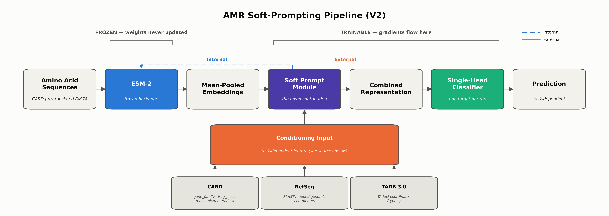
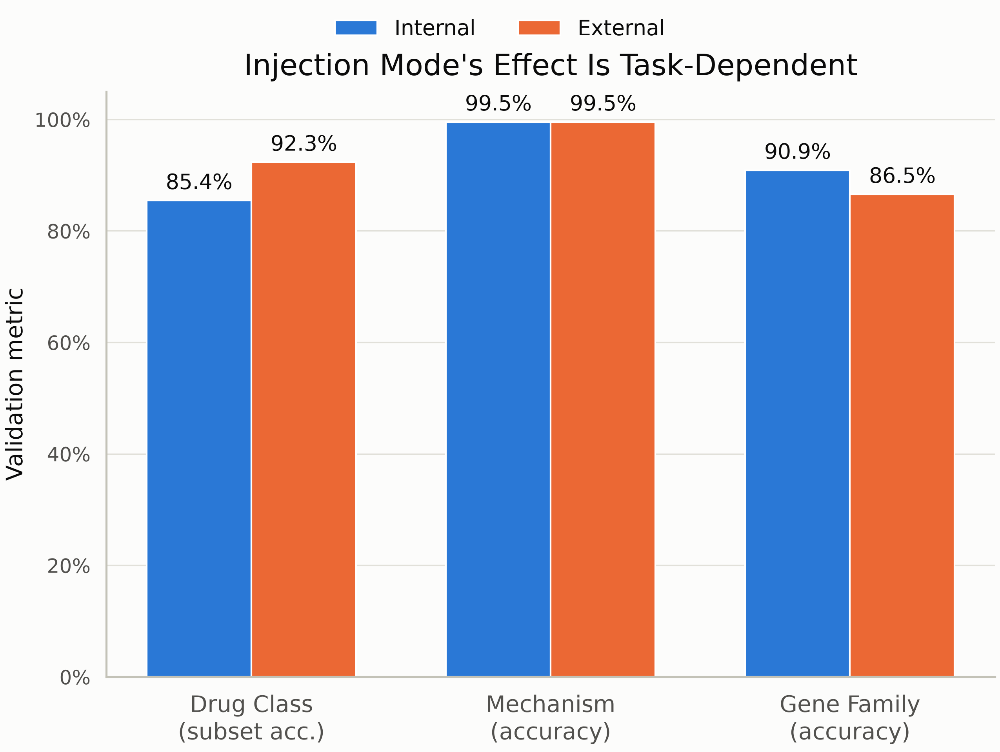
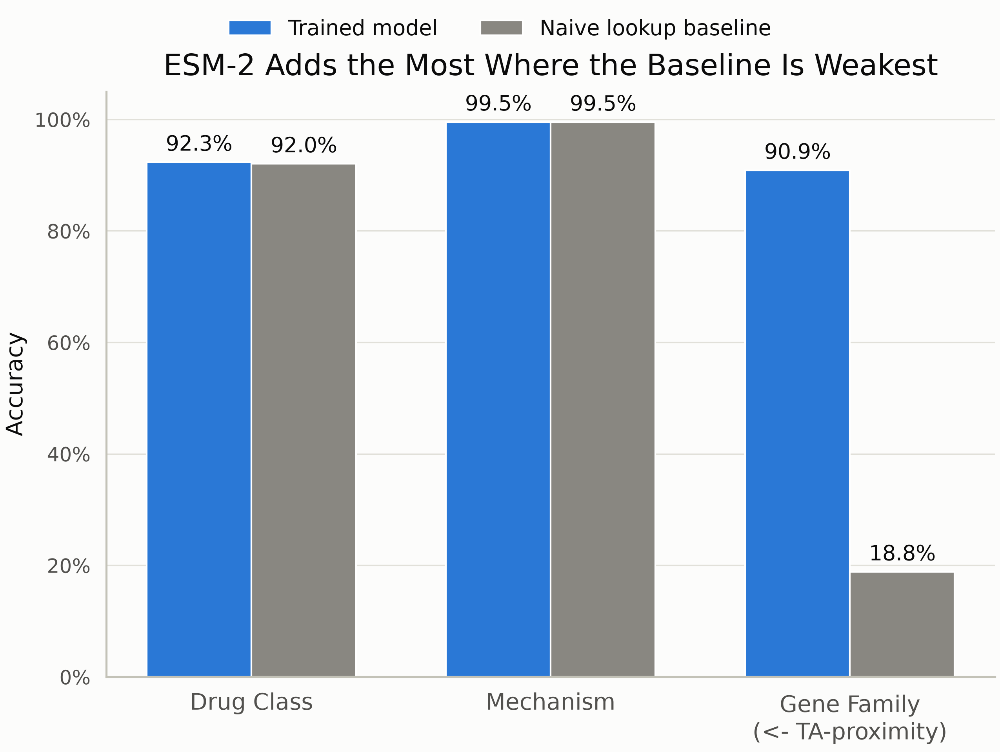
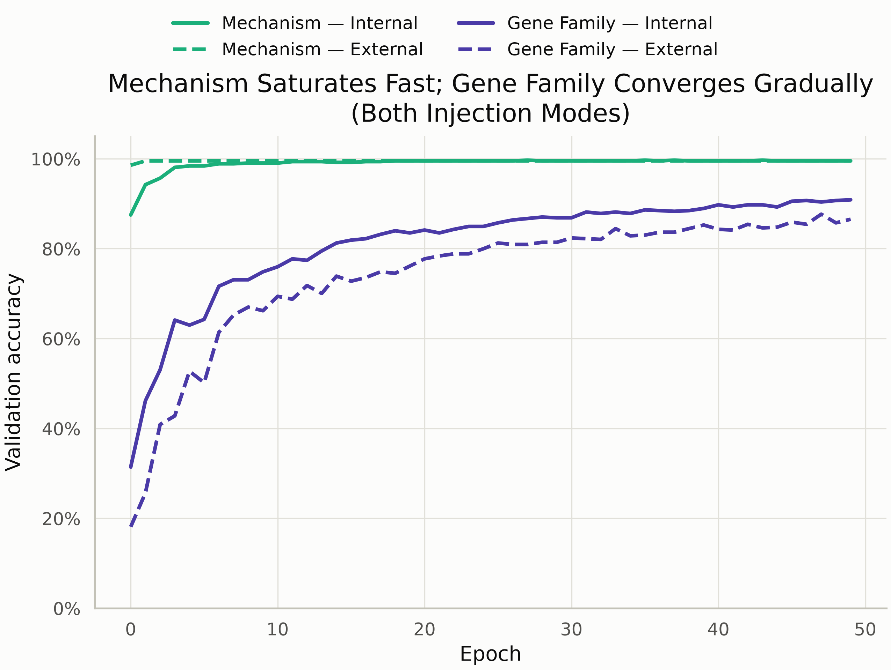
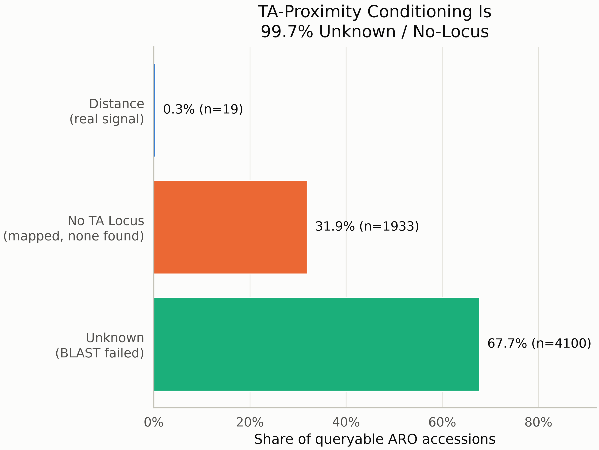
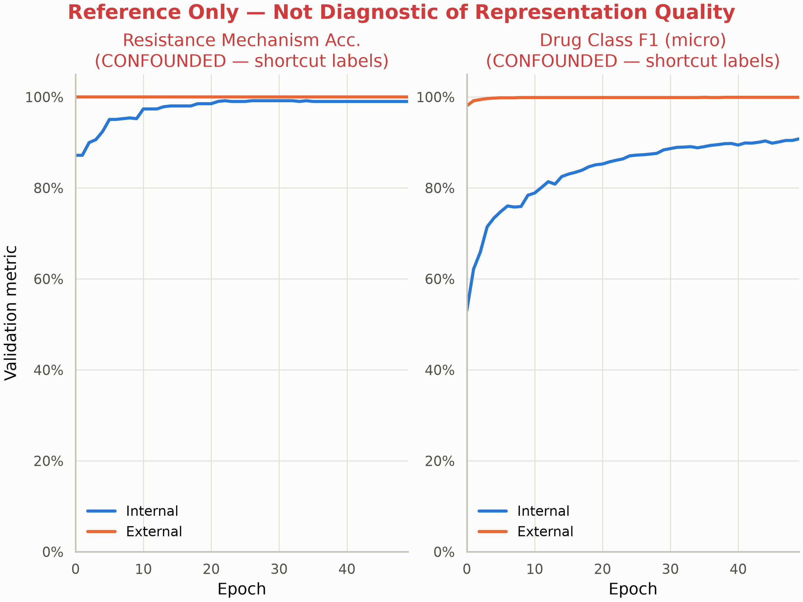

# Soft-Prompt Conditioned ESM-2 for Multi-Task Antimicrobial Resistance Prediction

**Aidan Nguyen, Annie Liang, Dr. William Andreopoulos**
Gavilan College, San José State University

---

## Background and Context

Antimicrobial resistance (AMR) is a major global health threat, linked to an estimated 1.27 million deaths worldwide in 2019 [1]. Traditional AMR gene annotation relies on sequence alignment against reference databases (e.g., BLAST), which struggles with novel sequences - exactly those most likely to signal emerging resistance.

Protein language models (PLMs) like ESM-2 learn protein function directly from sequence, without needing a close database match. We use ESM-2 as a **frozen backbone**, paired with a lightweight module that steers its representations toward task-relevant context.

[1] Antimicrobial Resistance Collaborators. "Global burden of bacterial antimicrobial resistance in 2019: a systematic analysis." *The Lancet*, vol. 399, no. 10325, 2022, pp. 629–655.

## Objective

To test how soft-prompt conditioning shapes frozen ESM-2's AMR predictions across tasks of varying signal strength, evaluated via an internal-vs-external soft-prompt injection-mode ablation.

## Significance

This work tests whether biological metadata can steer a frozen PLM's predictions without fine-tuning it, using **soft prompting** - a small set of learnable vectors injected into the model. This stays lightweight compared to full fine-tuning, while preserving ESM-2's existing sequence understanding.

---

## Architecture

**Figure 1: Pipeline Architecture**

Two injection modes are ablated:

- **Internal injection** — prepended before encoder: Amino Acid Sequences (CARD pre-translated FASTA) → ESM-2 (frozen backbone), with the Soft Prompt Module (conditioning input) injected before the encoder → Mean-Pooled Embeddings → Combined Representation → Single-Head Classifier (task-dependent) → Prediction (task-dependent)
- **External injection** — concatenated after pooling: Amino Acid Sequences → ESM-2 (frozen backbone) → Mean-Pooled Embeddings → Combined Representation (concatenated with Soft Prompt Module output) → Single-Head Classifier → Prediction

*(Per-mode diagrams: [internal](figures/fig6a_pipeline_internal.png), [external](figures/fig6b_pipeline_external.png))*

---

## Results

**Figure 2: Injection Mode's Effect Is Task-Dependent**

Injection mode's effect is task-dependent: external injection improves drug-class prediction (+7pp), meanwhile internal injection preserves gene-family accuracy under weak conditioning, and neither moves mechanism.

| Task | Internal | External |
|---|---|---|
| Drug Class (subset acc.) | 85.4% | 92.3% |
| Mechanism (accuracy) | 99.5% | 99.5% |
| Gene Family (accuracy) | 90.9% | 86.5% |

**Figure 3: ESM-2 Adds the Most Where the Baseline Is Weakest**

ESM-2 barely outperforms a naive conditioning-only baseline on drug class and mechanism, both are nearly tied but adds ~72 points on gene family, where that baseline is weakest.

| Task | Trained Model | Naive Lookup Baseline |
|---|---|---|
| Drug Class | 92.3% | 92.0% |
| Mechanism | 99.5% | 99.5% |
| Gene Family (← TA-proximity) | 90.9% | 18.8% |

**Figure 4: Mechanism Saturates Fast; Gene Family Converges Gradually (Both Injection Modes)**

Mechanism accuracy crosses 98% within the first few epochs and plateaus by ~epoch 18, while gene-family accuracy converges gradually across all 50.

**Figure 5: TA-Proximity Conditioning Is 99.7% Unknown / No-Locus**

TA-proximity conditioning is 99.7% unknown/no-locus, a real coverage gap between CARD and RefSeq/TADB 3.0, not a design choice, and the reason gene family's baseline is so weak.

| Category | Share of Queryable ARO Accessions |
|---|---|
| Unknown (BLAST failed) | 67.7% (n = 4,100) |
| No TA Locus (mapped, none found) | 31.9% (n = 1,933) |
| Distance (real signal) | 0.3% (n = 19) |

**Figure 6: Label Leakage Confound**

V1 conditioned two heads on their own ground-truth labels, letting them shortcut ESM-2 entirely. Accuracy hit near-ceiling by epoch 0. Reference-only chart, not diagnostic of representation quality — shows Resistance Mechanism Acc. (confounded / shortcut labels) and Drug Class F1 (micro) (confounded / shortcut labels) both spiking to near-ceiling almost immediately across epochs, for both internal and external modes.

---

## Label Leakage Confound

V1 conditioned two heads on their own ground-truth labels, letting them shortcut ESM-2 entirely. Accuracy hit near-ceiling by epoch 0 - fixed by ensuring conditioning input and prediction target are never the same field.

---

## Conclusions

Injection mode has no universal winner, since the best-performing mode depends on the task rather than the architecture. ESM-2's entire measurable contribution over a naive baseline is concentrated in gene family classification, where it beat the baseline by roughly 72 points. That gap traces back to data coverage - only 0.31% of ARO accessions mapped to a real TA-locus distance - leaving gene family as the one task with no metadata shortcut to lean on.

---

## Acknowledgements

**Funding:** U.S. Department of Education P031C210210
**Research Advisor:** Dr. William Andreopoulos

I would also like to extend my gratitude to Rachel Nguyen and David Argudo from Gavilan College, Eugenia Ayala-Servellon from SJSU for running this program, along with Annie Liang from Branham High School for her contributions to the TA-proximity pipeline and for the curiosity and dedication that made mentoring my first-ever intern such a pleasure.
